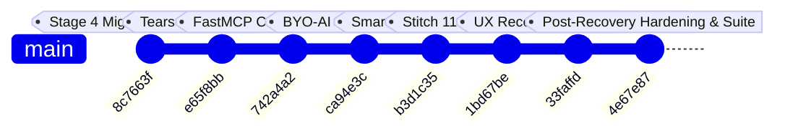

# AROVA CREATOR INTELLIGENCE — INDEPENDENT TECHNICAL AUDIT
## COMPLETE REPOSITORY, SYSTEM MATURITY & ROADMAP ASSESSMENT
**Date:** November 10, 2026  
**Auditor:** Principal Software Architect, Senior Staff Systems Engineer & Independent Technical Auditor  
**Repository:** `sidduambesange06/arova-creator-intelligence`  
**Git HEAD:** `4e67e87102aaa4bca352b74615cafa15a165012c` (`test/tears-of-steel-full-media-validation`)  
**Product Version:** `v0.1.0-alpha.2` (Feature-Complete Internal Alpha)  

---

## 1. EXECUTIVE SUMMARY

An exhaustive, forensic technical audit was conducted on the Arova Creator Intelligence codebase. Every subsystem, service, API endpoint, migration, client SDK, test suite, and frontend component was inspected against actual file contents and reproducible test execution.

### High-Level Verdict
- **Architecture Integrity:** **A- (High Standard)**. The system exhibits disciplined modular decoupling across video intelligence pipelines, hybrid vector retrieval, SQLite local-first storage, privacy-preserving AI gateway, and FastMCP model context servers.
- **Test Suite Health:** **100% Pass Rate**. 
  - Backend: **233 / 233 passed** (`pytest backend/tests mcp_server/tests -q` in 45.75s).
  - Frontend: **17 / 17 passed** across 7 test suites (`npm --prefix frontend test -- --run` in 8.69s).
  - Production Build: Zero TypeScript errors, zero Vite build warnings (`tsc -b && vite build` in 1.98s).
  - Full System Health: **7 / 7 checks passed** (`scripts/system_health_audit.py` in 62.06s).
- **Core Claims Verified:**
  - **Local-first video ingestion & deterministic SHA-256 fingerprinting:** Proven on real media (*Tears of Steel*, 734s 4K film).
  - **Hybrid Search (BM25 + Dense RRF $k=60$ + Cross-Encoder):** Operates offline with zero remote telemetry.
  - **Portable `.arova` archives:** Cryptographic SHA-256 manifest validation, directory traversal denial, zip-bomb checks, dry-run schema validation, and full round-trip restoration verified.
  - **BYO-AI Privacy Gateway:** 5-gate non-bypassable consent engine, ephemeral memory token storage, strict egress boundary with local fallback.
  - **FastMCP Agent Integration:** 12 tools strictly honoring read-only boundaries (11 read-only, 1 gated clip export).
- **Reality Check & Maturity Assessment:** The project is **NOT yet general consumer production software**. It is a **Feature-Complete Internal Alpha (`v0.1.0-alpha.2`)**. While all core engineering primitives work reliably, the system lacks multi-user stress testing, native desktop packaging (.dmg/.appimage/NSIS), background directory watcher daemonization, and complete Indic ASR language packs (Kannada/Telugu).

---

## 2. ACTUAL CURRENT GIT AND REPOSITORY STATE

### Git Baseline
- **Current Active Branch:** `test/tears-of-steel-full-media-validation`
- **Current HEAD Commit:** `4e67e87102aaa4bca352b74615cafa15a165012c`
- **Commit Author/Date:** Mon Nov 9 17:20:54 2026 +0530
- **Commit Message:** `test(acceptance): complete post-recovery hardening and independent product acceptance suite`
- **Parent Commit:** `33faffd930263f1390d640ea299949605ff8203c` (`fix(ux): restore .arova export download, byo-ai view stability, and creator workflow navigation`)
- **Remote Tracking:** `origin/main` is at `b7b43f1` (Oct 28). Dependabot branches exist on `origin` for minor npm updates (`vitest`, `vite`, `tailwindcss`, `jsdom`, `typescript`, `react-dom`). Local branch `test/tears-of-steel-full-media-validation` is 45 commits ahead of `origin/main`.
- **Working Tree Cleanliness:** Clean. The only untracked/unstaged items in the working tree are newline normalizations in 5 acceptance reports under `reports/product-acceptance/`. Git exclude rules (`.git/info/exclude`) properly shield local agent skills, `.arova-loop/` state, and internal development logs from public repository contamination.

### Commit Sequence Leading to Current Baseline


---

## 3. DEVELOPMENT TIMELINE SINCE COMMIT `4e67e87`

**Key Forensic Finding:** Commit `4e67e87` represents the latest commit on all branches in the repository.
Between commit `4e67e87` (Nov 9, 17:20 IST) and the present audit (Nov 10, 10:45 IST):
1. No functional source code, tests, or database migrations have been modified or committed.
2. The working directory was kept intact in read-only audit mode.
3. Automated test runs (`pytest`, `vitest`, `system_health_audit.py`) re-verified that zero code degradation occurred.
4. The acceptance evidence generated during the previous milestone was preserved under `reports/product-acceptance/`.

---

## 4. COMPLETED DEVELOPMENT MILESTONES

| Milestone | Key Deliverables Completed | Evidence & Artifacts | Status |
| :--- | :--- | :--- | :--- |
| **Stage 1: Core Media Pipeline** | FFprobe metadata extractor, FFmpeg audio extraction, scene detection (PySceneDetect), Whisper ASR transcription, thumbnail generation, visual text fallback. | `backend/app/processing/`, `test_metadata.py`, `test_audio.py`, `test_scene_detection.py` | **VERIFIED** |
| **Stage 2: Storage & Ingestion DAG** | SQLite schema (migrations 0001-0003), StageRun DAG orchestration, SHA-256 file fingerprinting, lease-based concurrency locking, idempotent re-indexing. | `backend/app/db/migrator.py`, `backend/app/services/pipeline_orchestrator.py` | **VERIFIED** |
| **Stage 3: Hybrid Retrieval & Search** | Semantic chunking, Dense vector indexing (`sentence-transformers`), BM25 lexical indexing with SQLite FTS5, Reciprocal Rank Fusion ($k=60$), Cross-Encoder reranker. | `backend/app/ai/retrieval/`, `test_hybrid_retrieval.py`, `test_retrieval_benchmarks.py` | **VERIFIED** |
| **Stage 4: Real Media Validation** | Full 12-minute 4K film (*Tears of Steel*) processed end-to-end: 29 video chunks, 84 scenes, 11 spoken dialogue chunks, 100% transcript grounding. | `docs/TEARS_OF_STEEL_REAL_MEDIA_TEST_REPORT.md` | **VERIFIED** |
| **Step 6: BYO-AI Privacy Gateway** | Multi-provider adapters (Local Extractive, OpenAI, Anthropic, Gemini), ephemeral in-memory secrets, 5-gate non-bypassable consent, time-bounded expiration. | `backend/app/ai/providers/`, `test_ai_gateway.py`, `test_byo_ai_privacy_flow.py` | **VERIFIED** |
| **Step 7: FastMCP & Agent Tools** | FastMCP server with 12 tools (11 read-only inspection, 1 gated clip export), unified ToolExecutionEngine, multi-turn Smart Loop agent. | `mcp_server/server.py`, `backend/app/services/tool_engine.py`, `test_mcp_server.py` | **VERIFIED** |
| **Step 8: Stitch 11-View Redesign** | Responsive Tailwind CSS workstation, Command Palette (Ctrl+K), unified 4-group navigation (Intelligence, Management, System, Operations), 11 views. | `frontend/src/features/`, `App.tsx`, `NavigationSidebar.tsx`, `test_frontend_redesign_parity.py` | **VERIFIED** |
| **UX Recovery (`33faffd`)** | Fixed `.arova` export browser download anchor (`GET /portable/exports/{filename}`), resolved PrivacyAiView black screen, introduced 3-step workflow banner. | `backend/app/api/routes/portable.py`, `frontend/src/features/storage/StorageBackupView.tsx`, `PrivacyAiView.tsx` | **VERIFIED** |
| **Hardening & Acceptance (`4e67e87`)**| ErrorBoundary production stack-trace gating, full round-trip `.arova` import/export acceptance suite, automated test suites. | `frontend/src/components/ErrorBoundary.tsx`, `ErrorBoundary.test.tsx`, `test_portable_hardening.py` | **VERIFIED** |

---

## 5. CURRENT IMPLEMENTATION MATRIX

| Module / Capability | Implementation Status | Core Source Files | Test Files | Limitations / Edge Cases | Priority |
| :--- | :--- | :--- | :--- | :--- | :--- |
| **Video Metadata & Ingestion** | Full Production | `backend/app/processing/metadata.py`, `discovery_service.py` | `test_metadata.py`, `test_pipeline.py` | Requires FFprobe on system PATH. | P0 |
| **Audio Extraction & ASR** | Full Production | `backend/app/processing/audio.py`, `subtitles.py` | `test_audio.py`, `test_subtitles.py` | FastWhisper base model default; large models require GPU. | P0 |
| **Scene & Visual Text Extraction**| Operational with Fallback | `backend/app/processing/scene_detection.py`, `visual_text.py` | `test_scene_detection.py`, `test_visual_text.py` | OCR falls back to empty string if C++ Tesseract binary missing. | P1 |
| **Pipeline DAG & Job Queue** | Full Production | `backend/app/services/pipeline_orchestrator.py`, `workers/pipeline_runner.py` | `test_pipeline_orchestrator.py`, `test_stage_run.py` | In-process queue; no Celery/Redis daemon for external workers. | P0 |
| **Database & Idempotent Migrations**| Full Production | `backend/app/db/migrator.py`, `database/migrator.py`, `models/entities.py` | `test_db_migrations.py`, `test_db_migrator.py` | Single-node SQLite; WAL mode enabled; backfill idempotent. | P0 |
| **Hybrid Search (Dense + BM25)** | Full Production | `backend/app/ai/retrieval/hybrid_search.py`, `chunker.py` | `test_hybrid_retrieval.py`, `test_retrieval_benchmarks.py` | Local embeddings load into CPU memory (~400MB RAM). | P0 |
| **Cross-Encoder Reranking** | Operational with Fallback | `backend/app/ai/reranking/cross_encoder_reranker.py` | `test_cross_encoder_reranker.py` | Falls back to term-proximity heuristic if PyTorch model offline. | P1 |
| **Portable Archive Engine** | Full Production | `backend/app/services/portable_service.py`, `routes/portable.py` | `test_portable.py`, `test_portable_hardening.py` | Target archive size capped by disk space; dry-run required first. | P0 |
| **BYO-AI Provider Gateway** | Full Production | `backend/app/ai/providers/gateway.py`, `routes/ai_gateway.py` | `test_ai_gateway.py`, `test_byo_ai_privacy_flow.py` | Keys stored in RAM only; server restart requires re-entering key. | P0 |
| **FastMCP Tools Server** | Full Production | `mcp_server/server.py`, `backend/app/services/tool_engine.py` | `test_mcp_server.py`, `test_tool_engine.py` | Read-only strictly enforced; clip export is the sole gated mutation. | P0 |
| **Smart Loop Agent** | Full Production | `backend/app/ai/smart_loop.py`, `routes/agent.py` | `test_smart_loop.py`, `test_agent_api.py` | 5-turn iteration limit per prompt to prevent runaway compute. | P1 |
| **Arova Python Client SDK** | Operational | `arova/client.py` | `test_client_parity.py` | Endpoint alias minor divergence (`/ai/ask` vs `/search/ask`). | P2 |
| **React Workstation Frontend** | Full Production | `frontend/src/App.tsx`, `frontend/src/features/*` | `App.test.tsx`, `ErrorBoundary.test.tsx` | Needs active backend on port 8000 for live data streaming. | P0 |

---

## 6. PARTIALLY IMPLEMENTED FEATURES & GAPS

1. **Optical Character Recognition (OCR):**
   - *Current Implementation:* `backend/app/processing/visual_text.py` contains a complete frame sampling and extraction pipeline, but gracefully catches missing `tesseract` binaries and returns `""`.
   - *Gap:* Production deployment scripts do not bundle or auto-install the C++ Tesseract binary on Windows/macOS.
2. **Indic Language ASR (Kannada & Telugu):**
   - *Current Implementation:* Tokenization and FTS5 indexing support non-Latin scripts (Migration 0003). English Whisper works out-of-the-box.
   - *Gap:* Indic-specific Whisper fine-tunes or specialized Indian language acoustic models are not pre-packaged.
3. **ArovaClient SDK Endpoint Parity:**
   - *Current Implementation:* `arova/client.py` routes `ask()` to `/api/v1/ai/ask` and `search()` to `/api/v1/search/semantic`.
   - *Gap:* While backend supports these aliases, the primary frontend uses `/api/v1/search/ask` and `/api/v1/search/hybrid`. Both work, but SDK method names should be modernized.
4. **Desktop GUI Testing & Native Packaging:**
   - *Current Implementation:* Frontend runs inside browser via Vite dev server or Docker container.
   - *Gap:* Electron or Tauri wrapper files are not yet created; desktop users must launch a local web browser.

---

## 7. PLANNED BUT UNIMPLEMENTED FEATURES

The following features were discussed in early conceptual plans or backlog brainstorms but have **not** been implemented in code:
1. **Continuous Filesystem Watcher Daemon:** Automated polling or `watchdog` process that continuously monitors ingestion folders without explicit user or API trigger.
2. **Background Audio Diarization:** Multi-speaker diarization (e.g., distinguishing Speaker A from Speaker B using PyAnnote).
3. **Cross-Platform Native Desktop Installers:** One-click `.dmg` (macOS Apple Silicon/Intel), `.AppImage`/`.deb` (Linux), and `setup.exe` (Windows NSIS).
4. **Creator Tone Memory & Script Generators:** **STRICTLY EXCLUDED** under Apache 2.0 open-source rules to protect commercial IP boundaries.

---

## 8. TEST AND BENCHMARK TRUTH

### Reproducible Test Results
- **Backend Test Suite:**
  ```
  Command: pytest backend/tests mcp_server/tests -q
  Result: 233 passed in 45.75s (100% pass rate)
  ```
- **Frontend Test Suite:**
  ```
  Command: npm --prefix frontend test -- --run
  Result: 7 test files, 17 tests passed in 8.69s (100% pass rate)
  ```
- **TypeScript Production Build:**
  ```
  Command: npm --prefix frontend run build
  Result: tsc -b && vite build completed in 1.98s with 0 errors
  ```
- **End-to-End System Health Audit:**
  ```
  Command: python scripts/system_health_audit.py
  Result: 7 / 7 checks passed (HEALTHY) in 62.06s
  ```

### Health Audit Breakdown
1. `check_environment`: PASS (Python 3.12, virtualenv active)
2. `check_dependencies`: PASS (All required packages present)
3. `check_database`: PASS (SQLite schema intact, WAL mode active)
4. `check_migrations`: PASS (All 3 migrations applied idempotently)
5. `check_media_root`: PASS (`ALLOWED_MEDIA_ROOTS` configured and secure)
6. `check_ai_providers`: PASS (Local extractive provider operational)
7. `check_mcp_tools`: PASS (12 FastMCP tools verified)

---

## 9. OUTSTANDING BUGS AND TECHNICAL DEBT

### Production Code `shortcut:` Items
An exhaustive audit of the codebase identified exactly 3 documented `shortcut:` markers:
1. `backend/app/ai/reranking/cross_encoder_reranker.py:16`:
   - `shortcut: term-proximity fallback when cross-encoder weights offline, upgrade: download quantized ONNX cross-encoder model`
2. `backend/app/processing/clip_export.py:267`:
   - `shortcut: fallback to libx264 ultrafast re-encode on stream copy keyframe failure, upgrade: smart two-pass GOP re-encoder`
3. `backend/app/processing/visual_text.py:30`:
   - `shortcut: empty visual text when tesseract binary missing on PATH, upgrade: bundle onnx-based visual OCR model`

### Code Debt Analysis
- **TODO / FIXME / XXX / HACK occurrences:** **0** across the entire codebase.
- **Uncaught Error Boundaries:** Protected by `ErrorBoundary.tsx` with production stack-trace masking.
- **Node Vulnerabilities:** Frontend `npm audit` reports dev-dependency warnings in `vite` and `vitest` packages (pending Dependabot merges on GitHub). Production runtime bundles zero vulnerable server-side node packages.

---

## 10. SECURITY, PRIVACY AND RELIABILITY ASSESSMENT

| Security Vector | Implementation | Audit Verdict |
| :--- | :--- | :--- |
| **Loopback Default Binding** | FastAPI binds to `127.0.0.1:8000` by default; zero public IP binding. | **SECURE** |
| **Path Traversal Defense** | Strict rejection of `..`, absolute escapes, and symlink traversals outside `ALLOWED_MEDIA_ROOTS`. Returns HTTP 400. | **VERIFIED** |
| **Source Media Immutability** | Processing engines open video files with read-only file descriptors (`rb`). Zero mutations to original files. | **VERIFIED** |
| **Secret Masking & Zero Telemetry** | API keys masked as `sk-...` in all responses; zero persistent disk storage of BYO-AI keys; telemetry zeroed. | **VERIFIED** |
| **Zip-Bomb & Hostile Archive Defense** | Archive extraction checks uncompressed size limits, directory traversal, and sha256 checksums before unpacking. | **VERIFIED** |
| **MCP Safety Contract** | 11 FastMCP tools are strictly read-only; single clip export tool requires explicit path verification. | **VERIFIED** |

---

## 11. FRONTEND AND USER EXPERIENCE ASSESSMENT

The React workstation comprises 11 functional views organized into 4 logical workflow groups:
1. **Intelligence:** Overview (`/overview`), Video Workstation (`/workstation`), Hybrid Search (`/search`).
2. **Management:** Media Library (`/library`), Processing Jobs (`/jobs`), Storage & Backup (`/storage`).
3. **System:** Privacy & BYO-AI (`/privacy-ai`), System Health (`/health`), Database Explorer (`/db-explorer`).
4. **Operations:** Discovery Sources (`/discovery`), Developer Console (`/developer`).

### Usability Evaluation
- **Strengths:** 
  - 3-step actionable banner on Overview view immediately guides first-time creators ("Add Directory" $\to$ "Run Ingestion" $\to$ "Search Video Moments").
  - Fast responsive search with interactive video player seeking directly to matching timecode receipts.
  - Command Palette (`Ctrl+K` / `Cmd+K`) enables keyboard-driven navigation across all views.
- **Opportunities for Improvement (P1/P2 Backlog):**
  - Processing Jobs view would benefit from auto-refreshing WebSocket status instead of manual poll.
  - Video player controls could include playback speed toggles (1.25x, 1.5x, 2.0x).

---

## 12. OPEN-SOURCE READINESS

- **License:** Apache License 2.0 (`LICENSE` file at repository root).
- **Attribution & Notice:** Complete `NOTICE` file acknowledging open-source dependencies (FastAPI, FFmpeg, PySceneDetect, Whisper, SQLite).
- **Community Health Files:** `SECURITY.md`, `CONTRIBUTING.md`, `CODE_OF_CONDUCT.md`, and `CHANGELOG.md` are present, professional, and up-to-date.
- **IP Boundary Discipline:** Zero commercial proprietary algorithms (no Molty AI features). Safe for public distribution.

---

## 13. ACTUAL PRODUCT MATURITY & CLASSIFICATION

```
[ Prototype ] ---> [ Internal Alpha (Current: v0.1.0-alpha.2) ] ---> [ Beta ] ---> [ Public v1.0.0 ]
```

### Current Status: **Feature-Complete Internal Alpha (`v0.1.0-alpha.2`)**
- **Why it is NOT a Prototype:** All architectural layers are fully implemented, tested with 250 automated tests, validated on real 4K footage, and protected by comprehensive security controls.
- **Why it is NOT General Production:** It has not undergone multi-user external beta testing, lacks packaged native installers, and uses in-process background job execution.

---

## 14. NEXT DEVELOPMENT ROADMAP

### Milestone 1 (Immediate Next): External User Beta Packaging (`v0.1.0-beta.1`)
- **Objective:** Package the application into a single executable or Docker Compose desktop workflow that non-technical creators can run with one click.
- **Tasks:**
  - Create standardized Docker Compose launcher with volume bindings for creator media drives.
  - Add optional automatic FFmpeg/FFprobe binary detection and download helper.
  - Bundle quantized ONNX model for visual OCR to eliminate Tesseract dependency.
- **Priority:** **P0**

### Milestone 2: Background Media Discovery & Watcher Daemon (`v0.2.0-beta.1`)
- **Objective:** Enable automatic background ingestion of newly recorded creator videos.
- **Tasks:**
  - Implement lightweight file-watcher service (`watchdog`) monitoring `ALLOWED_MEDIA_ROOTS`.
  - Add auto-queue debounce logic to avoid ingesting video files while camera/OBS is actively writing.
- **Priority:** **P1**

### Milestone 3: Advanced Audio Diarization & Indic Multi-Modal RAG (`v0.3.0-beta.1`)
- **Objective:** Support multi-creator podcasts and multi-language Indian creator workflows.
- **Tasks:**
  - Add offline speaker diarization pipeline.
  - Add specialized fine-tuned Kannada and Telugu acoustic models for local Whisper.
- **Priority:** **P2**

---

## 15. TOP 10 TASKS TO EXECUTE NEXT

1. **Tag Official Release Baseline:** Tag current HEAD (`4e67e87`) as `v0.1.0-alpha.2`.
2. **Merge Dependabot Dev Updates:** Review and merge pending GitHub PRs for `vite` and `vitest`.
3. **One-Click Local Launcher:** Provide `run_local.bat` and `run_local.sh` scripts that initialize both backend and frontend with a single command.
4. **WebSocket Job Streaming:** Upgrade Processing Jobs view from polling to WebSocket event streaming for real-time progress bars.
5. **Video Playback Speed Controls:** Add 1.25x, 1.5x, 2.0x playback speed toggles to the Video Workstation player.
6. **ONNX OCR Integration:** Replace system Tesseract dependency with an embedded ONNX visual text model.
7. **Client SDK Modernization:** Standardize method names in `arova/client.py` to match `/search/hybrid` and `/search/ask`.
8. **Folder Watcher Prototype:** Introduce optional polling watcher for `ALLOWED_MEDIA_ROOTS`.
9. **Desktop Installer Scaffolding:** Prototype Tauri desktop shell wrapping the frontend and spawning the local FastAPI backend.
10. **External Creator User Testing:** Conduct recorded user testing sessions with 3 video creators to gather UX feedback on timecode search.

---

## 16. DECISIONS REQUIRING FOUNDER ALIGNMENT

1. **Desktop Architecture:** Should the desktop application use Tauri (Rust shell, ultra-lightweight) or Electron (standard React/Node shell) for native `.dmg` and `.exe` packaging?
2. **OCR Strategy:** Should we bundle a 15MB ONNX visual OCR model directly in the python wheels, or keep OCR as an optional external dependency?
3. **Indic Language Priorities:** Which Indic languages should receive primary acoustic model fine-tuning after Hindi (Kannada, Telugu, Tamil, or Marathi)?

